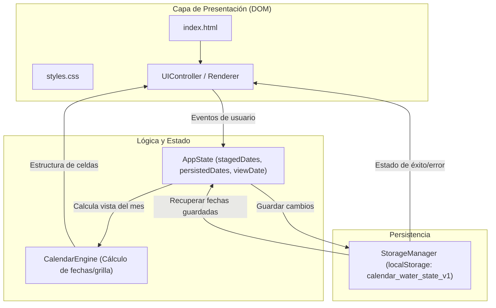

# Arquitectura del Sistema: Calendario de Agua

## 1. Visión General y Principios

**Calendario de Agua** está diseñado bajo una arquitectura de cliente puro (Single Page Application sin framework) basada en los estándares web modernos (HTML5, CSS3 y JavaScript ES6+ nativo).

### Principios Fundamentales
1. **Cero dependencias:** No se utilizan bibliotecas externas, gestores de paquetes (npm), herramientas de compilación/empaquetado (webpack, vite) ni frameworks de interfaz (React, Vue).
2. **Autonomía y ejecución en cliente:** La aplicación opera 100% en el navegador del usuario utilizando `localStorage` para la persistencia.
3. **Separación clara de responsabilidades:**
   - **Estructura semántica:** `index.html`
   - **Capa de presentación y diseño responsivo:** `styles.css`
   - **Lógica de aplicación, estado y almacenamiento:** `app.js`

> [!NOTE]
> **Estado Real:** Al momento de redactar este documento, los archivos `index.html`, `styles.css` y `app.js` **aún no han sido creados**. Esta arquitectura define el diseño técnico que se implementará en las fases posteriores.

---

## 2. Estructura de Archivos del Proyecto

```text
Antigravity-CalendarWater/
├── index.html       # Markup semántico, contenedores de calendario, controles y accesibilidad ARIA
├── styles.css       # Estilos CSS, variables de color/tema, layout grid/flexbox y diseño responsivo
└── app.js           # Módulos de lógica: motor de calendario, gestión de estado y StorageManager
```

---

## 3. Arquitectura Modular en `app.js`

La lógica en `app.js` se organizará en módulos funcionales bien delimitados:



### 3.1 `CalendarEngine`
- **Responsabilidad:** Cálculos temporales del calendario sin acoplamiento a la persistencia.
- **Funcionalidades:**
  - Obtener el nombre del mes y año en español a partir de una fecha base.
  - Determinar el primer día de la semana asegurando que **Lunes = 0** y **Domingo = 6** (ajuste del estándar JS donde Domingo = 0).
  - Calcular la cantidad total de días del mes en curso y los días residuales de meses adyacentes para completar la cuadrícula mensual (matriz de semanas).
  - Formatear e interpretar fechas canónicas en formato ISO estricto `YYYY-MM-DD`.

### 3.2 `AppState` (Gestión del Estado de la Aplicación)
- **Responsabilidad:** Mantener la verdad del estado de la interfaz y la separación entre lo confirmado y lo editado.
- **Estructura del Estado:**
  - `viewDate: { year: number, month: number }` (Mes y año actualmente visibles en la cuadrícula).
  - `persistedDates: Set<string>` (Conjunto de cadenas `YYYY-MM-DD` confirmadas y leídas desde `localStorage`).
  - `stagedDates: Set<string>` (Conjunto de cadenas `YYYY-MM-DD` en edición activa en memoria).
  - `isDirty: boolean` (Indicador booleano derivado que evalúa si `stagedDates` difiere de `persistedDates`).

### 3.3 `StorageManager`
- **Responsabilidad:** Abstraer las operaciones de entrada/salida sobre `localStorage` con validación y tratamiento de errores.
- **Clave de almacenamiento:** `calendar_water_state_v1`
- **Esquema de Datos Versionado (JSON):**
  ```json
  {
    "version": 1,
    "waterDates": [
      "2026-10-05",
      "2026-10-12",
      "2026-10-19",
      "2026-11-02"
    ],
    "updatedAt": "2026-10-04T22:52:00.000Z"
  }
  ```
- **Políticas del StorageManager:**
  - **Validación defensiva:** Filtra entradas no válidas (que no cumplan el patrón `YYYY-MM-DD`).
  - **Ordenamiento canónico:** Las fechas se guardan ordenadas cronológicamente para facilitar la depuración y coherencia.
  - **Conservación total:** No aplica reglas de caducidad ni borra fechas pasadas o futuras.
  - **Captura de excepciones:** Envuelve llamadas a `localStorage.setItem` y `getItem` en bloques `try/catch` para manejar `QuotaExceededError`, `SecurityError` (modo privado bloqueado) o almacenamiento inhabilitado.

### 3.4 `UIController` / `Renderer`
- **Responsabilidad:** Renderizar la vista en el DOM y gestionar los listeners de eventos.
- **Componentes renderizados:**
  - Encabezado con título, mes/año visible y botones de navegación ("Anterior", "Siguiente", "Hoy").
  - Barra de días de la semana (Lun, Mar, Mié, Jue, Vie, Sáb, Dom).
  - Cuadrícula de días interactivos (botones/celdas con `aria-pressed`, clases para día actual, día seleccionado y fuera de mes).
  - Barra de acciones: Botón "Guardar cambios", indicador de cambios pendientes (badge/texto) y contenedor de notificaciones accesibles (`aria-live="polite"`).

---

## 4. Diferencia Operativa: Navegación, Guardado y Recarga

Es crítico entender el ciclo de vida del estado ante cada una de estas tres acciones:

| Operación | Estado en Memoria (`stagedDates`) | Estado Persistido (`persistedDates`) | Almacenamiento (`localStorage`) | Interfaz / Visualización |
| :--- | :--- | :--- | :--- | :--- |
| **Navegación** *(Mes Ant. / Sig.)* | **Se conserva intacto.** Mantiene todas las fechas añadidas o eliminadas en cualquier mes de la sesión. | **Sin cambios.** | **No se interactúa con el storage.** | Actualiza `viewDate`. Renderiza el nuevo mes mostrando marcados aquellos días presentes en `stagedDates`. El indicador de cambios pendientes permanece activo si hay diferencias. |
| **Guardado** *(Clic en "Guardar cambios")* | **Se mantiene.** Pasa a ser la nueva base de verdad confirmada. | **Se sincroniza:** `persistedDates = new Set(stagedDates)`. | **Se serializa y escribe** el JSON completo con todas las fechas únicas. | Se desactiva el indicador de cambios pendientes (`isDirty = false`). Se muestra un mensaje visual de éxito ("Cambios guardados correctamente") o de error si el storage falló. |
| **Recarga** *(F5 / Refresh del navegador)* | **Se descarta.** Se reinicializa con los datos leídos de `persistedDates`. | **Se lee de `localStorage`** mediante `StorageManager.loadState()`. | **Solo lectura.** | La página vuelve al mes actual del sistema. Muestra exclusivamente las fechas que fueron guardadas previamente en `localStorage`. Cualquier cambio que no se guardó antes de recargar se pierde de forma natural. |

---

## 5. Estrategia de Manejo de Fechas y Zonas Horarias

Para evitar los errores comunes de desfasaje de fechas derivados del huso horario (`Date.toISOString()` vs hora local):
1. **Identificador canónico de fecha:** Cada día del calendario se maneja exclusivamente como una cadena de texto en formato `YYYY-MM-DD` (ej. `2026-10-14`).
2. **Cálculos de calendario:** Se construirán instanciando fechas locales utilizando año, mes y día de forma explícita (`new Date(year, monthIndex, day)`), sin parsing de strings ISO ambiguos que puedan generar desfases horarios por UTC.
3. **Día actual ("hoy"):** Se extrae `year`, `month` y `day` de `new Date()` local para componer el string `YYYY-MM-DD` de comparación.

---

## 6. Accesibilidad (a11y) y Diseño Responsivo

- **Teclado:**
  - Las celdas de los días del mes serán elementos interactivos semánticos (`<button type="button" class="calendar-day">`) o contarán con `tabindex="0"`, `role="button"` y soporte para `Enter` y `Space`.
  - Estados de foco nítidos (`:focus-visible`) que garanticen la navegación accesible.
- **Lectores de pantalla:**
  - Cada botón de día incluirá un `aria-label` descriptivo (ej. `"15 de octubre de 2026, llegará agua"` o `"15 de octubre de 2026, sin programación"`).
  - Estado interactivo con `aria-pressed="true|false"`.
  - Región de notificaciones con `role="status"` y `aria-live="polite"` para anunciar resultados del guardado.
- **Responsividad:**
  - Cuadrícula mediante CSS Grid (`grid-template-columns: repeat(7, 1fr)`).
  - Diseño `mobile-first` adaptable a pantallas estrechas (mínimo 320px) y ordenado para uso cómodo en pantallas táctiles y ratón.
