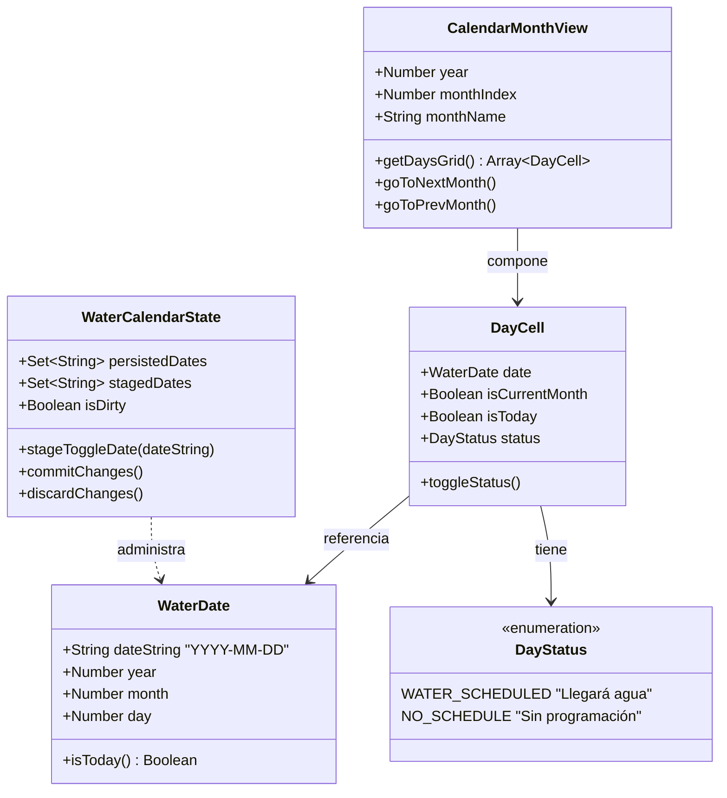

# Modelo de Dominio: Calendario de Agua

## 1. Resumen del Dominio

El dominio del proyecto **Calendario de Agua** modela la planificación y consulta temporal de las fechas previstas para la recepción de agua potable. Se enfoca exclusivamente en la calendarización de días con suministro, prescindiendo de asignaciones de personas o roles.

---

## 2. Conceptos Principales

### 2.1 `WaterDate` (Fecha de Agua)
- **Propósito:** Representa un día de calendario específico donde se prevé el suministro de agua.
- **Formato canónico:** Cadena en formato ISO `YYYY-MM-DD` (ej. `"2026-10-15"`).
- **Reglas:**
  - Debe ser una fecha válida del calendario gregoriano.
  - Es única dentro del conjunto de fechas; no existen duplicados.

### 2.2 `DayStatus` (Estado del Día)
- **Propósito:** Define la condición de suministro de un día del calendario.
- **Valores posibles:**
  - **`Llegará agua` (Marcado / Activo):** El día ha sido seleccionado por el usuario como fecha con suministro programado.
  - **`Sin programación` (Desmarcado / Inactivo):** Estado predeterminado en el que no hay previsión de llegada de agua.

### 2.3 `CalendarMonthView` (Vista del Mes)
- **Propósito:** Representa el contexto temporal y visual que se proyecta en la pantalla.
- **Reglas:**
  - Se define por un año (`year`) y un mes (`month`, 0-11).
  - La cuadrícula de días inicia ineludiblemente el día **Lunes** y concluye en **Domingo**.
  - Permite avanzar o retroceder indefinidamente a meses pasados o futuros.

### 2.4 `DayCell` (Celda del Calendario)
- **Propósito:** Unidad interactiva que vincula una fecha con la vista mensual.
- **Atributos:**
  - `date`: Instancia de fecha o string `YYYY-MM-DD`.
  - `isCurrentMonth`: Indica si el día pertenece al mes que se está visualizando o si es un día adyacente para rellenar la semana.
  - `isToday`: Indica si coincide con la fecha real del sistema del usuario.
  - `status`: Estado actual (`Llegará agua` o `Sin programación`) según el contenido de `stagedDates`.

### 2.5 `WaterCalendarState` (Estado Global de la Aplicación)
- **Propósito:** Coordina la persistencia y la interacción en memoria durante la sesión.
- **Colecciones:**
  - `persistedDates`: Conjunto (`Set`) de fechas guardadas de forma duradera en el navegador.
  - `stagedDates`: Conjunto (`Set`) de trabajo que refleja las modificaciones del usuario en tiempo real.
  - `isDirty`: Estado booleano que determina si `stagedDates` y `persistedDates` tienen diferencias.

---

## 3. Reglas de Negocio del Dominio

1. **Unicidad e Inmutabilidad de Fechas:** Cada fecha en formato `YYYY-MM-DD` es una clave única. Marcar una fecha la agrega al conjunto de trabajo; desmarcarla la retira.
2. **Independencia y Conservación de Fechas:** No existe límite temporal para las fechas registradas. Las fechas guardadas en cualquier mes o año (pasado, presente o futuro) se mantienen indefinidamente y no son eliminadas por navegar o guardar otros meses.
3. **Edición Multimes en Memoria:** El usuario puede marcar fechas en el mes actual, navegar a tres meses en el futuro, marcar otras fechas, regresar, y todas esas selecciones seguirán vivas en `stagedDates`.
4. **Guardado Total y Atómico:** Al pulsar "Guardar cambios", se toma la totalidad de `stagedDates` y se persiste en `localStorage` como la nueva verdad del sistema.
5. **Aislamiento de Recarga:** La recarga de la página restablece el estado en memoria al último estado persistido (`stagedDates = new Set(persistedDates)`), descartando cualquier edición no confirmada.

---

## 4. Descarte Explícito de la Plantilla Anterior

> [!IMPORTANT]
> **Aclaración sobre conceptos de la plantilla previa:**
> Los conceptos y entidades descritos en versiones iniciales de la plantilla (tales como `Person`, `Monica`, `Cristiam`, `Enanillas-Cabezoncin`, `CleaningAssignment`, `Weekday` asignado a personas y ventanas de retención de 2 meses) pertenecen a un proyecto anterior de limpieza y quedan **completamente anulados y descartados**. No forman parte de este dominio.
